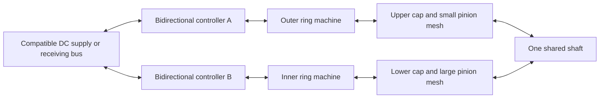

# Soupy's twin-ring concept: first motor and generator sizing pass

Reviewed 2026-10-18. No battery voltage, dimensions, duty cycle, shaft speed, or power target has been selected. The examples below establish scale; they are not a matched pair, a buying recommendation, or a prediction for this mechanism.

## What the motor names mean

Frameless describes a rotor/stator kit integrated into your own bearings, housing, and cooling structure. It does not prescribe one torque or speed. A torque motor is designed around producing useful torque directly; its actual speed range still depends on winding, voltage, cooling, and mechanical limits. The smaller inner machine could also be frameless. [Kollmorgen frameless overview](https://www.kollmorgen.com/en-us/products/motors/frameless-motors)

A hub motor is an integrated package. A direct-drive hub couples its rotor to the rotating shell; a geared hub contains a faster internal motor and reduction gearing. Many geared hubs freewheel, preventing normal back-driving for generation. A direct-drive or deliberately non-freewheeling construction is relevant to the generator version. [Grin hub types](https://ebikes.ca/resources/getting-a-kit/hub-motor-options.html), [Grin regeneration](https://ebikes.ca/resources/learn/regen.html)

## Two real reference points

| Example | Published continuous operating point | Electrical reference |
|---|---|---|
| Kollmorgen TBM(S)-7631-A frameless | 307 W at 2,300 rpm; 1.65 N·m continuous **stall** torque is a separate operating point | 48 V DC bus; 8.90 A RMS continuous motor current, not battery current |
| Grin original All-Axle, 27 mm stator, direct-drive hub | At 300 rpm: 900 W dry, or 1,275 W with Statorade | Standard 6T winding: 10 rpm/V; about 480 rpm unloaded at 48 V. Loaded speed is lower. |

The Kollmorgen point corresponds to approximately 1.27 N·m at 2,300 rpm, calculated from power and speed. Its peak stall rating is 5.37 N·m at a cold 25°C winding, not continuous output. Ratings assume 25°C ambient and the specified housed installation/heat sink. [Kollmorgen guide, pp. 9–10](https://www.kollmorgen.com/sites/default/files/Kollmorgen_TBM_Frameless_Motor_Selection_Guide.pdf#page=9)

Grin's continuous power table uses a 110°C core limit; the installation's cooling matters. Bicycle airflow cannot simply be assumed inside a stationary generator enclosure. Motor-side current conventions must be obtained for the chosen winding/controller. These are motor-output figures, not verified generator ratings. [Grin manufacturer data](https://ebikes.ca/product-info/grin-products/all-axle-hub-motor.html)

The hub example is substantially larger. Its higher low-speed torque does not establish that hubs inherently outperform frameless machines.

## One battery, two independently controlled machines

Both controllers can share a compatible DC bus. Each needs its own motor phases, position feedback/commutation, current limits, and torque command. They need not supply equal currents or equal effective phase voltages. The same bus voltage can therefore support different operating points.

Motor phase current and battery current are different quantities. In the usual torque-controlled operating region, motor torque approximately follows its torque-producing current. Battery current instead follows total electrical power divided by actual bus voltage. Voltage and back EMF constrain the available speed range. Match RMS, peak, phase, and line-current conventions to the manufacturer's torque constant. [Grin motor/controller explanation](https://ebikes.ca/resources/web-tools/simulator.html)

For example, **2 kW mechanical output**, **85% assumed overall motor-mode efficiency**, and a **48 V bus** would require about **2,353 W electrical input**, or **49 A total bus current**. These are hypothetical system assumptions, not ratings of the examples above.

The gears mechanically fix relative speeds. A coordinated speed loop can allocate different torque shares to the two drives, allowing one to carry more load when the other approaches its current or temperature limit. That requires deliberate control and remaining capacity; it is not automatic. A coupled-drive torque-follower arrangement is an established control pattern. [Rockwell load-sharing application note](https://support.rockwellautomation.com/ci/okcsFattach/get/750915_5)

Proposed electrical arrangement, not implemented hardware:

In generator service, each machine needs suitable conversion and load control. Their raw three-phase outputs should not be assumed compatible with each other: different speeds or pole counts can produce different electrical frequencies. A controlled common DC connection is a separate electrical design.

## Ratios have to be resolved before choosing windings

Define each validated branch ratio as `g = shaft RPM / ring RPM`, using speed magnitudes. Then:

- `ring RPM = shaft RPM / g`.
- Motor mode: `shaft torque contribution = gear efficiency × ring torque / g`.
- For a chosen shaft torque share `a`, required ring torque is `a × shaft torque × g / gear efficiency`.
- Generator mode: shaft torque needed for a generator's resisting ring torque is `ring torque / (reverse gear efficiency × g)`.

Large caps driving smaller pinions speed up the shaft. Driving that shaft in reverse power flow slows the rings relative to it. Low generator RPM therefore becomes a key winding/voltage question. Reversing power flow does not require reversing rotation direction.

The app now resolves these ratios: see **Mechanism analysis** in the editor and [ANALYSIS-MODEL.md](ANALYSIS-MODEL.md). Its upper decorative tooth ratio is 96/12 = 8, while its drawing radii give 320/30 ≈ 10.67. Its lower tooth ratio is 72/36 = 2.

**Correction to an earlier figure.** This study previously gave the lower radii ratio as 270/90 = 3, using the cap's outer radius. The rolling radius is where the pinion actually sits, which is X=256, not the cap's 270 edge, so the lower ratio from the drawing is 256/90 ≈ 2.844. Every ratio-dependent figure below that was derived from 3 should be read against 2.844.

The two ratios in each pair disagree because the members state different modules: 5 mm on both pinion sections against 6.67 mm on the upper cap and 7.11 mm on the lower. Equal module is necessary for any real mesh, so these pairs cannot turn as drawn. The editor offers two reconciliations — restate the cap tooth counts (128 and 102), or resize the pinion sections (40 mm and 128 mm radius) — and flags that the second drives the enlarged large section into the upper cap. The right-angle tooth form remains unresolved either way. All animation rates remain illustrative unless the motion repair has been applied.

## How much could the generator version produce?

The calculation begins with mechanical input:

`Pshaft [W] = torque [N·m] × RPM × 2π / 60`

Total delivered electrical power is shaft input minus gear, bearing, machine, and converter losses. Each machine must also remain within its continuous torque/speed/current/thermal limits. Generated voltage depends on speed and winding, and drops under load; a motor's advertised wattage alone is insufficient to predict generator output. [maxon generator engineering guide](https://support.maxongroup.com/hc/en-us/articles/360004496254-maxon-Motors-as-Generators)

**Illustrative calculation only:** 100 N·m applied to the input shaft at 300 rpm is 3.14 kW mechanical input. With an assumed 80% total shaft-to-electrical efficiency, the two generators together would deliver about 2.51 kW. At a regulated 48 V output, that is about 52 A. This does not establish that the present geometry or any selected pair can handle that load.

The editor now computes this chain from the drawn geometry. Entering the same duty point with 96% gear, 90% machine, and 95% converter efficiency gives 2.58 kW and 53.7 A at 48 V — the 82.1% chain rather than the 80% assumed above.

**What that pass reveals about the rings.** Because the two branch ratios differ (10.67 and 2.844), one shaft speed produces two very different ring speeds. At 300 rpm on the shaft the upper ring turns 28.1 rpm and the lower 105.5 rpm. Splitting shaft torque evenly, the upper machine must resist about 512 N·m and the lower about 137 N·m for the same 1.5 kW each. A machine delivering useful torque at 28 rpm is a very different proposition from one at 105 rpm, and the required torques differ by nearly 4:1. This is the winding and voltage question the ratios were blocking, now stated in numbers.

The next sizing pass should choose a useful shaft speed/torque range, settle the right-angle tooth form, then compare continuous machine envelopes and cooling against the per-ring torques and speeds above. Machine selection and power predictions remain open.
